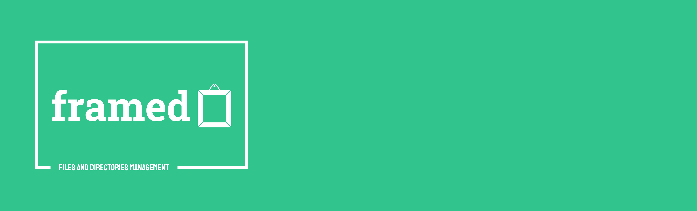
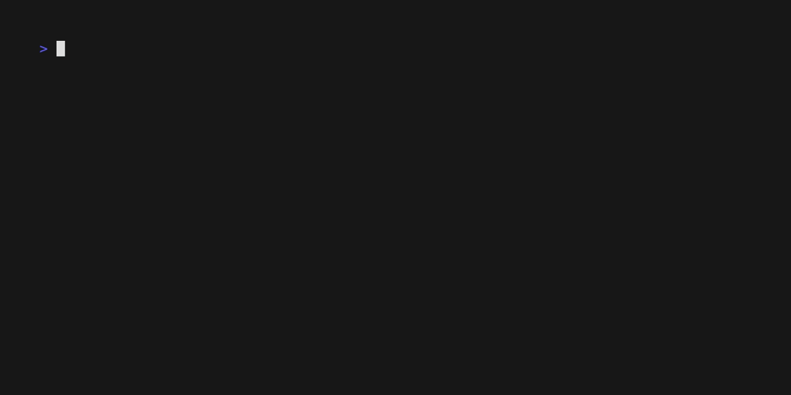

[](https://github.com/mactat/framed/actions/workflows/release.yaml) [](https://github.com/mactat/framed/actions/workflows/pr.yaml)      

# Framed — Files and Directories Reusability, Architecture, and Management

Framed is a CLI tool that defines project layouts as YAML and keeps
them in sync. Capture a structure, import one from a template, verify
in CI that your repo still matches.

## Table of contents

- [Quick start](#quick-start)
- [Features](#features)
- [Usage](#usage)
- [Configuration](#configuration)
- [Installation](#installation)
- [Docker](#docker)
- [GitHub Action](#github-action)
- [Contributing](#contributing)

## Demo



## Quick start

```shell
brew tap mactat/mactat && brew install framed   # install
framed import --example golang                  # grab a starter template
framed verify                                   # check the repo against it
```

Three commands and you're enforcing structure. Replace `golang` with
any of the [available examples](./examples).

## Features

- **YAML templates** — describe directories, files, patterns,
  counts, and depth limits in one file.
- **CI-friendly verify** — `framed verify` exits non-zero on drift,
  drops cleanly into pipelines (a [GitHub Action](#github-action) is
  provided).
- **Capture and import** — derive a template from an existing repo,
  or pull a shared one from a URL or the bundled examples.
- **Nested template imports** — compose templates from smaller
  pieces with the `template:` field on any dir.

## Usage

By default Framed reads `./framed.yaml`. Override with
`--template path/to/file.yaml`.

| Command | What it does |
|---|---|
| `framed create` | Materialize the dirs (and optionally `--files`) defined in the template. |
| `framed verify` | Walk the repo and fail if anything drifts from the template. |
| `framed capture --output <file>` | Derive a template from the current directory. |
| `framed visualize` | Print the template as a tree. |
| `framed import --url <url>` | Pull a template from a URL. |
| `framed import --example <name>` | Pull one of the bundled [examples](./examples). |

Available examples: `python`, `golang`, `node`, `rust`, `terraform`,
`monorepo`, `docs-site`.

## Configuration

A template is a YAML file with a `name` and a `structure` tree. Each
node in `dirs:` can use any of these fields:

| Field | Type | Applies to | Description |
|---|---|---|---|
| `name` | string | dir | Directory name. |
| `files` | list | dir | Files required to exist in this dir. |
| `dirs` | list | dir | Nested directories. |
| `allowedPatterns` | list | dir | Regex(es) — every file in the dir must match at least one. |
| `forbiddenPatterns` | list | dir | Regex(es) — no file in the dir may match. |
| `minCount` | int | dir | Minimum number of files. |
| `maxCount` | int | dir | Maximum number of files. |
| `allowChildren` | bool | dir | If `false`, subdirectories are not allowed. Default `true`. |
| `maxDepth` | int | dir | Maximum nesting depth below this dir. |
| `template` | string | dir | Local path or URL of another template to import in place of this dir's subtree. |

Short example:

```yaml
name: framed
structure:
  name: root
  maxDepth: 5
  files:
    - README.md
    - go.mod
  dirs:
    - name: cmd
      allowedPatterns:
        - ".go"
      forbiddenPatterns:
        - "_test.go"
    - name: dockerfiles
      minCount: 1
      allowChildren: false
      allowedPatterns:
        - "dockerfile"
    - name: shared
      template: ./shared.yaml   # imported in place
```

See [`examples/`](./examples) for full, real-world templates.

## Installation

### Homebrew

```shell
brew tap mactat/mactat
brew install framed
```

### Manual install

Download the archive for your OS from the
[releases page](https://github.com/mactat/framed/releases) and put the
binary on your `PATH`.

| OS | Archive | Recommended install path |
|---|---|---|
| macOS | `framed-darwin-amd64-<version>.tar.gz` | `/usr/local/bin/` |
| Linux | `framed-linux-amd64-<version>.tar.gz` | `/usr/local/bin/` |
| Windows | `framed-windows-amd64-<version>.tar.gz` | A directory on `%PATH%` (e.g. `C:\Windows`) |

On macOS/Linux:

```shell
tar -xzf framed-<os>-amd64-<version>.tar.gz
chmod +x framed
sudo mv framed /usr/local/bin/
```

On Windows: extract with 7-Zip/WinRAR and move `framed.exe` to a
directory on `%PATH%`.

## Docker

```shell
docker run --rm -v $(pwd):/app --user $(id -u):$(id -g) mactat/framed framed <command>
```

Example:

```shell
docker run --rm -v $(pwd):/app --user $(id -u):$(id -g) mactat/framed framed import --example python
```

Images on [Docker Hub](https://hub.docker.com/r/mactat/framed).

## GitHub Action

```yaml
name: Verify Project Structure
on: [push, pull_request]
jobs:
  verify:
    runs-on: ubuntu-latest
    steps:
      - uses: actions/checkout@v3
      - name: Verify Project Structure
        uses: mactat/framed-action@v0  # pin to the latest release tag
        with:
          template: './framed.yaml'    # optional
```

Pin `mactat/framed-action` to the
[latest release](https://github.com/mactat/framed-action/releases).

## Contributing

See [`CONTRIBUTING.md`](./CONTRIBUTING.md) for project layout, local
dev, and the PR checklist. Open work is tracked as cards under
[`todo/`](./todo/) — pick one, or add a new card before starting
something substantial.
